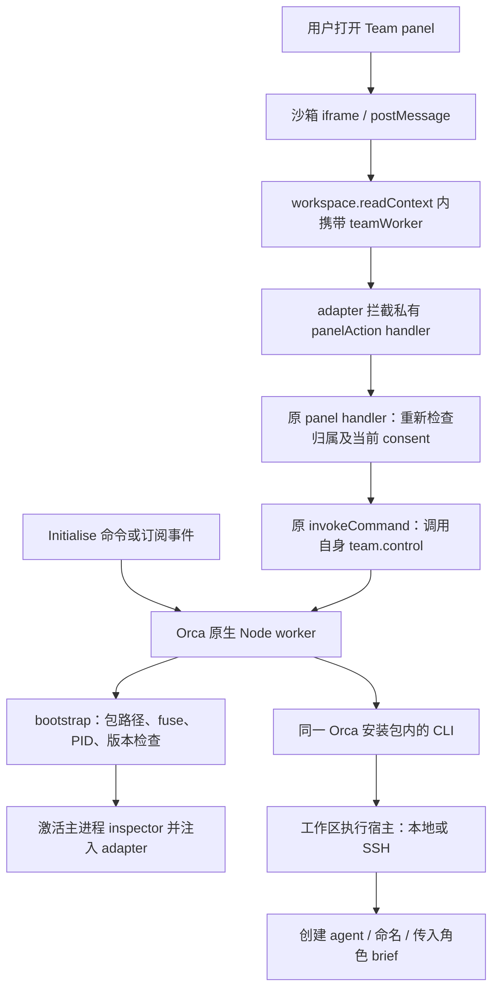

# Team Orchestrator 迁移到 Orca plugin：机制与启动故障分析

研究日期：2026-10-15。目标目录：`team-orchestrator-orca-plugin/`，当前插件版本 `0.1.06`（manifest SemVer `0.1.6`）。本报告区分已读源码、可复现故障和仍未完成的实际启动验证；阅读与验证过程中不修改已安装 Orca，不开启 inspector，不注入运行中主进程，也不启动新的 agent。

目前的核心判断是：**插件界面和 Node worker 都已经实现，阻塞点在 panel 与 worker 之间的连接。Orca 官方 plugin API 尚未提供这条通道，当前版本通过运行时注入补上；而 macOS 的注入前置检查读取了错误的二进制文件，提前将本来开启的 inspector fuse 判为不可用。** 修复该路径可以消除一个确定的阻塞，但不能据此宣称完整的多 agent 启动或编排已经工作。

## 1. 研究边界与版本

官方 Orca 源码临时下载在 `/tmp/orca-plugin-research-20261015-925`，没有放进业务仓库。研究时的 `main` 为 `02356732b0a4b8fa46aefead303f6f092611c18d`，提交日期 2026-10-15，`package.json` 中的版本是 `1.4.214`。本机安装包为 `1.4.222`，其构建 SHA 为 `9fdd90ffa7721e145f1353ad9fb9df2f70c31f43`；同一临时 clone 中也下载了该提交。两个提交的关键 plugin manifest、host API、worker、panel、commands/events 文件内容一致，因此下文优先引用本机对应 SHA，不以版本号字段推断分支新旧。

官方用户文档只给了 Plugins 的实验性入口和权限概览，没有在已查阅的文档树中提供完整 plugin 开发教程。因此，API 结论以官方实现的 schema、capability gate、worker runtime 和 panel controller 为准。官方明确要求打开 Settings → Plugins 的总开关，再分别审阅并启用插件；worker 始终在当前电脑运行，SSH 工作区操作通过 Orca 路由。[官方设置说明](https://www.onorca.dev/docs/settings#plugins-experimental)、[固定版本文档](https://github.com/stablyai/orca/blob/9fdd90ffa7721e145f1353ad9fb9df2f70c31f43/docs/site/content/docs/settings.mdx#L158-L163)

## 2. Herman 原版 Claude Code 的实现

Herman 的核心做法是让每个成员成为独立的 Claude Code 会话，在这些会话中加载同一个 mod，以 Orca CLI 管理终端，以 Claude Code 会话 API 传消息，再用角色文件、状态文件和工具拦截维持团队运行。组织树里的 Head、Lead、Worker 首先是成员及汇报关系的数据；它们的行为来自角色指令和运行时规则。[主入口](../team-orchestrator/hooks/register.tsx)、[角色文件](../team-orchestrator/hooks/roles.ts)

仓库各部分的职责如下，不能把三个 Claude Code mod 的 marketplace 当作 Orca 插件安装清单：

| 目录 | 职责 | 与启动问题的关系 |
| --- | --- | --- |
| `.claude-plugin/` | `herman-mods` marketplace，列出三个 Claude Code mod | 不负责加载 Orca panel |
| `team-orchestrator/` | 原版团队创建、会话消息、身份、状态、队列和 guard，当前 `0.5.37` | 需要迁移的主要业务行为 |
| `session-panel/` | 会话内计划、进度、提问和 assumptions，当前 `0.3.63` | assumptions 集成是可选项，不是 Orca 启动前提 |
| `speaker-colours/` | 改写用户与助手消息的 UI 样式 | 与团队启动无关 |
| `team-orchestrator/hermes/` | Hermes 的工具 guard 和安装补丁检查 | 不是 Orca worker 的安装器 |
| `team-orchestrator-orca-plugin/` | 独立 Orca manifest、HTML panel、Node worker、runtime adapter 及测试 | 当前故障所在 |

目录与版本依据：[仓库说明](../README.md)、[marketplace](../.claude-plugin/marketplace.json)、[Hermes guard](../team-orchestrator/hermes/guard.py)。`crypto.ts`、`vault.ts` 是跨设备通信的加密与密钥保存准备，README 明确远程 messenger 尚未建成；不能据这些文件认定跨设备编排已经可用。[原版范围](../team-orchestrator/README.md)

**Claude Code 内的注册与 UI。** `.claude-plugin/plugin.json` 提供 mod 元数据，`hooks/hooks.json` 加载 `register.tsx`。该文件通过 `import ... from 'claude-code'` 使用宿主提供的 API，在 `session.start` 注册 `/team` 以及 `team_launch`、`team_adopt`、`team_message`、`member_add` 等工具；用 `ui.render` 的 `AbovePrompt` / `Pane` 渲染界面，用 atom 保存 UI 状态。这里的工具、会话和 hook API 属于 Claude Code 的执行环境，Orca iframe 没有相同的对象可调用。[hooks 清单](../team-orchestrator/hooks/hooks.json)、[工具注册](../team-orchestrator/hooks/register.tsx#L2587)、[UI 注册](../team-orchestrator/hooks/register.tsx#L3142)

**组织树如何变成运行中的成员。** 表单和预设先产生带有 `name / role / boss / level / model / effort` 的成员列表。`launch()` 先保存完整 roster，然后根据 All 或 Demand 选出首批成员，分批调用 `orca terminal create --worktree id:... --title ... --command ...`。新进程带有明确的 Claude `--session-id`、`--name`、模型/effort、`--append-system-prompt` 以及首条欢迎任务。随后等待终端就绪并刷新状态；恢复已关闭成员则可使用 `--resume`。所以 Orca 在原版中负责承载和控制独立进程，团队决策与协作逻辑主要在 Claude mod 中。[创建流程](../team-orchestrator/hooks/register.tsx#L2375)、[启动参数](../team-orchestrator/hooks/register.tsx#L759)、[恢复与消息入口](../team-orchestrator/hooks/register.tsx#L1681)

**角色如何持续生效。** mod 直接生成 `.claude/team-orchestrator/roles/<name>.md`，上半部随 roster 更新，用户笔记区被保留。短系统提示给出身份、上级、关键规则和文件位置，要求初次行动及上下文压缩后重读。经理负责分配和检查，执行者向直属上级汇报。相比之下，Orca 原型只把角色写入启动 brief，并让模型自行保存 `.orca/team-orchestrator/.../roles/...md`；文件是否生成以及以后是否重读，尚没有同等级别的程序保障。[角色生成与保护笔记](../team-orchestrator/hooks/roles.ts#L25)、[文件写入](../team-orchestrator/hooks/register.tsx#L739)、[Orca 启动 brief](../team-orchestrator-orca-plugin/src/launch.mjs#L6)

**成员之间如何通信。** 原版 `team_message` 会按 roster 找人，必要时启动或恢复成员，受会话数量上限限制时先排队，随后调用 `$.session.send({to: {sessionId}, text})`。正在运行的会话也可以使用 Claude 的 `SendMessage`，相关 hooks 负责部分恢复和清理提醒。实际投递使用会话 ID，避免同名会话或 Remote Control 镜像误收。Orca `terminal.send` 在代码中用于部分启动 briefing，但常规团队协作依赖会话消息通道。[准确投递](../team-orchestrator/hooks/register.tsx#L1544)、[启动与排队](../team-orchestrator/hooks/register.tsx#L1681)、[SendMessage hook](../team-orchestrator/hooks/register.tsx#L2839)

**运行状态与一致性。** 成员通过 `turn.start`、`turn.complete`、提问 hook 和 60 秒 heartbeat 写本机状态；30 秒刷新读取这些文件。团队结构保存在项目内，状态在 `~/.claude/team-orchestrator/<project>/status/`，两者职责不同。团队顶层会话负责落盘 roster，其他会话提交 `changes/` 增量，避免多人覆盖；顶层还负责空闲回收、消息队列、故障恢复和有条件的 Orca 查询。身份判断结合 terminal handle、session ID 和名称，证据不足时进入待确认状态。[事件状态](../team-orchestrator/hooks/register.tsx#L2859)、[定时任务](../team-orchestrator/hooks/register.tsx#L2739)、[单写入者](../team-orchestrator/hooks/register.tsx#L621)、[身份规则](../team-orchestrator/hooks/identity.ts)

**权限规则有代码执行点。** `tool.call` 对 Agent、文件写入和 shell 工具进行检查：成员默认不能随意启动 subagent，有下属的经理默认不能自己写业务文件，团队文件有单独的写入规则。它比单纯在 prompt 里写“请遵守层级”多了一层工具调用检查；移植到不同 provider 时，需要分别找可用的 hook 或执行边界。[guard 注册](../team-orchestrator/hooks/register.tsx#L2829)、[guard 规则](../team-orchestrator/hooks/guard.ts)

| 能力 | Claude Code 原版 | Orca 原型 `0.1.06` |
| --- | --- | --- |
| 组织树、预设、层级模型 | 已实现 | 已实现，可保留 |
| 创建首批成员 | Orca CLI + Claude 启动参数 | worker + CLI，受当前桥接故障阻断 |
| 跨 provider | 主要管理 Claude；其他 CLI 有限制 | 能为 Codex / Claude 构造启动请求 |
| 角色持久化 | 程序生成文件 + 系统提示指针 | 启动 brief 要求模型自行写文件 |
| 后续按需启动 | 首次 `team_message` 自动触发 | 仅决定创建时启动哪些人；没有后续触发器 |
| 消息、队列、恢复 | 已有运行逻辑 | 尚未移植 |
| 实时 working / idle / asking | 会话 hooks + heartbeat | 展示创建回执，不能等同实时工作状态 |
| 权限 guard | 会话内工具检查 | 没有等价实现 |

迁移版界面中虽然有 On demand，但源码 `initialMembers()` 只筛选首批 CEO/Heads；其 brief 同时要求不要自行创建额外成员。后续 worker 何时由谁启动，仍需要显式实现。不能认为选择该选项已经获得原版的完整按需调度。[首批筛选](../team-orchestrator-orca-plugin/src/launch.mjs#L1)、[插件已声明的范围](../team-orchestrator-orca-plugin/README.md)

## 3. Orca 的 plugin 契约实际上开放了什么

### Manifest 与加载

插件根目录使用 `orca-plugin.json`。身份为 `publisher.id`，`manifestVersion` 与 `pluginApi` 当前都为 `1`，版本必须是严格 SemVer，`engines.orca` 当前仅接受 `>=x.y.z`。`main` 是可选的 Node worker 入口，不是 panel 的入口；panel 自己在 `contributes.panels[].entry` 指定 HTML。因此当前把展示版本写成 `0.1.06`、manifest 写成 `0.1.6` 是正确处理。[manifest schema](https://github.com/stablyai/orca/blob/9fdd90ffa7721e145f1353ad9fb9df2f70c31f43/src/shared/plugins/plugin-manifest.ts#L32-L129)

`contributes` 是严格对象，当前允许 panels、commands、events、languagePacks、keybindings、vmRecipes、agents。存在普通 worker command 或事件订阅时必须有 `main`；声明事件还必须声明 `events:subscribe`。当前插件已经具备这些项目，不能把故障归结为遗漏 `main`、commands 或事件 capability。[贡献校验](https://github.com/stablyai/orca/blob/9fdd90ffa7721e145f1353ad9fb9df2f70c31f43/src/shared/plugins/plugin-manifest-contribution-validation.ts#L117-L142)、[本地 manifest](../team-orchestrator-orca-plugin/orca-plugin.json)

`contributes.agents` 的存在也不等于向插件提供了 `agent.launch`：它在 schema 中只是 `{path}` 形式的内容贡献，运行时动作仍由独立 host API 表决定。[agents 贡献 schema](https://github.com/stablyai/orca/blob/9fdd90ffa7721e145f1353ad9fb9df2f70c31f43/src/shared/plugins/plugin-content-pack-contributions.ts#L44-L55)

Orca 支持安装目录和 development plugin path 两种发现方式。开发路径需要指向含有 `orca-plugin.json` 的实际插件根目录，即本项目的 `team-orchestrator-orca-plugin/`，不能只把整个 `925-cc-plugins/` 当作该插件根目录。[发现与 artifact 检查](https://github.com/stablyai/orca/blob/9fdd90ffa7721e145f1353ad9fb9df2f70c31f43/src/main/plugins/plugin-discovery.ts#L26-L35)、[manifest 定位](https://github.com/stablyai/orca/blob/9fdd90ffa7721e145f1353ad9fb9df2f70c31f43/src/main/plugins/plugin-discovery.ts#L75-L125)

### Panel 的能力明显少于 worker

Panel 是 `sandbox="allow-scripts"` 的 opaque-origin iframe，通过 `postMessage` 发起动作，由宿主复核窗口身份、session token、capability 和参数。CSP 明确 `connect-src 'none'`，不能通过 panel 直接访问 localhost HTTP/WebSocket 服务来解决通信缺口。[panel bridge](https://github.com/stablyai/orca/blob/9fdd90ffa7721e145f1353ad9fb9df2f70c31f43/src/shared/plugins/plugin-panel-bridge.ts#L4-L13)、[CSP](https://github.com/stablyai/orca/blob/9fdd90ffa7721e145f1353ad9fb9df2f70c31f43/src/shared/plugins/plugin-panel-shell.ts#L20-L22)

| 官方方法 | Panel | Worker | 对 Team Orchestrator 的含义 |
| --- | --- | --- | --- |
| `workspace.readContext` | 可用 | 可用 | 仅工作区名称、分支、terminal ID 列表；不直接提供完整 workspace identity |
| `terminal.sendText` | 可用 | 可用 | 向指定的已有 terminal 输入文字；不创建或命名 agent |
| `notifications.show` | 可用 | 可用 | 桌面通知 |
| `storage.*` | 不可用 | 可用 | 团队持久化需要 worker |
| `secrets.*`、`settings.*` | 不可用 | 可用 | 插件私有状态 |
| `events.subscribe` | 不可用 | 可用 | 接收有限的宿主事件 |
| 启动、命名 agent；调用自身 worker command | 没有该公开方法 | host API 中也没有 launch/rename；原生 worker 可另走 CLI | 这是迁移所缺的宿主连接能力 |

上表来自唯一的公开 API 定义表。Panel 动作列表直接从 `panel: true` 派生；不是给 manifest 再添一条权限就能扩展。当前 capability 也只有七种，随意填写 `agent:launch`、`process:exec` 等名称会被 schema 拒绝。[Host API](https://github.com/stablyai/orca/blob/9fdd90ffa7721e145f1353ad9fb9df2f70c31f43/src/shared/plugins/plugin-host-api.ts#L122-L265)、[capability 闭集](https://github.com/stablyai/orca/blob/9fdd90ffa7721e145f1353ad9fb9df2f70c31f43/src/shared/plugins/plugin-capabilities.ts#L10-L29)

这里最关键的一行是 `workspaceReadContextParams = z.object({}).strict().optional()`。官方只接受空对象或省略参数。现有插件却把 `{teamWorker: ...}` 塞入该调用；没有注入 adapter 时，这个请求必然在参数校验处返回 `invalid_params`，无法到达 worker。[严格空参数](https://github.com/stablyai/orca/blob/9fdd90ffa7721e145f1353ad9fb9df2f70c31f43/src/shared/plugins/plugin-host-api.ts#L25-L43)、[实际校验入口](https://github.com/stablyai/orca/blob/9fdd90ffa7721e145f1353ad9fb9df2f70c31f43/src/main/plugins/plugin-host-methods.ts#L31-L56)、[本地 envelope](../team-orchestrator-orca-plugin/src/worker-bridge.mjs)

### Worker 需要触发，而且有单独的信任边界

Orca 用 `child_process.fork` 启动独立 Node worker，注入 `ELECTRON_RUN_AS_NODE=1`、清理环境变量及 `execArgv`，然后加载插件 `main` 的默认导出 `activate(orca)`。SDK 提供 `commands.register`、`events.on`、`host.call` 与日志。`activate` 完成后才向父进程发送 ready。[启动过程](https://github.com/stablyai/orca/blob/9fdd90ffa7721e145f1353ad9fb9df2f70c31f43/src/main/plugins/plugin-host-process.ts#L79-L100)、[worker SDK 与 ready](https://github.com/stablyai/orca/blob/9fdd90ffa7721e145f1353ad9fb9df2f70c31f43/src/main/plugins/plugin-host-runtime.ts#L69-L120)

Worker 是懒启动：宿主调用插件 command 时执行 `workerController.ensure`，订阅的事件发生时也会 ensure；读取 panel entry 只加载 HTML，不 ensure worker。因此“面板已经打开”和“后台 worker 已启动”是两个独立状态。当前插件通过 `team.initialise` 命令或 `worktree.created` / `agent.status.changed` 事件启动后台，这个设计符合已存在的契约，但首次连接仍依赖触发顺序。[命令激活](https://github.com/stablyai/orca/blob/9fdd90ffa7721e145f1353ad9fb9df2f70c31f43/src/main/plugins/plugin-service.ts#L271-L281)、[事件激活](https://github.com/stablyai/orca/blob/9fdd90ffa7721e145f1353ad9fb9df2f70c31f43/src/main/plugins/plugin-event-delivery.ts#L23-L39)、[panel 加载](https://github.com/stablyai/orca/blob/9fdd90ffa7721e145f1353ad9fb9df2f70c31f43/src/main/plugins/plugin-panel-controller.ts#L134-L162)

增加 `main` 会改变 consent fingerprint，即使 capability 列表不变也需要重新审阅原生 worker 信任。声明 capability 限制的是 host API，不代表原生 Node 进程本身被限制为只能做这几件事。当前插件能使用文件系统、子进程和 inspector，正是因为它在这个可信原生执行层运行。[worker 信任指纹](https://github.com/stablyai/orca/blob/9fdd90ffa7721e145f1353ad9fb9df2f70c31f43/src/shared/plugins/plugin-consent-fingerprint.ts#L19-L35)、[实际权限 gate](https://github.com/stablyai/orca/blob/9fdd90ffa7721e145f1353ad9fb9df2f70c31f43/src/shared/plugins/plugin-capability-gate.ts#L34-L62)

## 4. 当前迁移版如何补上这条连接



这条实现不是缺文件的半成品。`main.mjs`、`runtime-adapter.cjs`、自包含 `panel.html` 已打包；`src/worker.mjs` 注册命令并检查当前 host authority；`src/local/bootstrap.mjs` 检查后注入 adapter；`src/local/adapter.mjs` 包装 `ipcMain._invokeHandlers` 中的内部 handlers；`src/local/executor.mjs` 管理启动日志、实际 handle、命名及回执。[本地入口](../team-orchestrator-orca-plugin/src/worker.mjs)、[bootstrap](../team-orchestrator-orca-plugin/src/local/bootstrap.mjs)、[adapter](../team-orchestrator-orca-plugin/src/local/adapter.mjs)、[executor](../team-orchestrator-orca-plugin/src/local/executor.mjs)

Adapter 对已有 panel session 绑定，只转发本插件两个声明命令，并调用原有 panel / command gate。这些检查有价值；但依赖 `_invokeHandlers`、内部 IPC 名称和主进程 inspector，仍属于对宿主内部实现的适配，不是 Orca 承诺支持的插件通信接口。升级兼容性不能仅由 `engines.orca >=1.4.0` 保证。当前 bootstrap 还仅接受 `1.4.x` 应用版本，因此 manifest 的宽范围也不等于 adapter 的实际兼容范围。[本地 adapter](../team-orchestrator-orca-plugin/src/local/adapter.mjs)、[版本检查](../team-orchestrator-orca-plugin/src/local/bootstrap.mjs)

## 5. 本机故障：macOS 检查读错了文件

当前 `bootstrap()` 默认使用 `process.execPath`，随后直接 `readFile(executable)` 并查找 Electron fuse sentinel。macOS 的 `.../Orca.app/Contents/MacOS/Orca` 是应用入口，真正的 fuse 位于 `Contents/Frameworks/Electron Framework.framework/Electron Framework`。Electron 官方 `@electron/fuses` 为这两个输入形式（`.app` 根目录或 `Contents/MacOS/` 可执行文件）专门做了映射。[本地第 43–49 行](../team-orchestrator-orca-plugin/src/local/bootstrap.mjs)、[Electron 官方路径转换](https://github.com/electron/fuses/blob/42ee9430478abbba387e68b5b0c4c5d08133f4cc/src/index.ts#L44-L76)

因此，这里要区分两种完全不同的结果：找不到 sentinel 可能是读错文件；只有读取正确的 Electron framework 后发现 index 3 为禁用，才可判断 inspector fuse 被关闭。官方说明 `EnableNodeCliInspectArguments` 禁用会同时阻止 `--inspect` 参数和 `SIGUSR1` 激活 inspector。本机实测的该位是开启的，不能把当前故障描述成“Orca 发行包禁止调试”。[Electron fuse 文档](https://www.electronjs.org/docs/latest/tutorial/fuses#nodecliinspect)

用户确认的故障阶段是：面板能够打开，但 Test connection 或 Launch 失败。对当前 Mac 的只读检查得到：

| 检查项 | 结果 |
| --- | --- |
| 安装包 | `/Applications/Orca.app`，版本 `1.4.222`，Apple Silicon |
| 构建提交 | `9fdd90ffa7721e145f1353ad9fb9df2f70c31f43`，来自包内 `orca-local-build.json` |
| 开发插件路径 | 已指向本仓库的 `team-orchestrator-orca-plugin/` |
| 插件总开关和禁用列表 | 总开关为 true，本插件未被禁用 |
| 当前 manifest 授权 | 用安装包的 `fingerprintPluginConsent` 计算后，与保存的授权完全匹配 |
| manifest schema | 用安装包的 `parsePluginManifest` 校验，`ok: true` |
| 应用入口 | `Contents/MacOS/Orca`，53,632 bytes，未找到 fuse sentinel |
| 真正的 Electron framework | 195,341,280 bytes，fuse v1 / length 9 / states `101100011`，index 3 为开启 |

直接调用仓库里的 `inspectorFuse()` 读取上述两个文件，结果分别为 `false` 和 `true`。调用同一 `bootstrap()`，把 executable 指向本机 Orca 入口，并用禁止执行的替身替换 inspector 激活函数，得到以下结果；激活函数从未被调用：

```json
{
  "ready": false,
  "detail": "This executable does not expose an enabled Electron inspector fuse. Nothing was injected.",
  "activationAttempted": false
}
```

这复现了当前代码在此安装包上的必经失败点，但不是从用户 UI 日志中抄录的报错。另用安装包自带的 host API schema 校验当前 `teamWorker` envelope，得到 `Unrecognized key: "teamWorker"`；空参数 `{}` 可通过。两组结果共同解释了连接失败链：worker 即使被命令或事件启动，也会在注入前退出 bootstrap；没有 adapter 时，面板请求仍被官方参数校验拒绝。[本地失败点](../team-orchestrator-orca-plugin/src/local/bootstrap.mjs#L48)、[面板连接请求](../team-orchestrator-orca-plugin/src/worker-bridge.mjs#L23)

此外，bootstrap 将错误捕获为 `ready: false` 的普通返回值，worker 会缓存该 Promise。后续 Test connection 或事件不会自动清掉这份失败结果；`team.initialise` 才会重置缓存并重试。首次懒启动、初始化失败和已经连接应显示为不同状态，用户才能知道下一步做什么。[缓存与重试](../team-orchestrator-orca-plugin/src/worker.mjs#L10)

本次运行 `npm test`，25 项全部通过。`npm run test:host` 首次在 macOS 默认临时目录下失败：临时 root 使用 `/var/folders/...`，esbuild 对 importer 使用 `/private/var/folders/...`，脚本的字符串前缀检查没有匹配，导致无法解析九个源码模块。以 `env TMPDIR=/private/tmp npm run test:host` 使用规范路径后通过。这个结果还说明验证脚本需处理 realpath，但它不是生产插件启动失败的原因。[验证脚本路径判断](../team-orchestrator-orca-plugin/scripts/verify-host.mjs#L36)

host test 使用仓库指定的 Orca 提交 `dc146c09e2b12c229cc38434b7b1d4d9c012fdc5` 和模拟 IPC registry，能验证契约及授权检查，不能证明真实应用上的 inspector 注入或 agent 启动。此次没有做会创建 agent 的实机验收。

当前单位测试验证的是合成 fuse bytes 和 macOS 包类型字符串，没有覆盖“macOS app 入口路径解析到 framework 后读取 fuse”的真实组合；README 也说明原生注入仅在 Linux Electron fixture 上验证，macOS/Windows 未做实际原生验证。所以现有测试全部通过与本机 bootstrap 提前退出并不矛盾。[测试覆盖](../team-orchestrator-orca-plugin/test/local.test.mjs)、[验证边界](../team-orchestrator-orca-plugin/README.md)

## 6. Orca CLI 能做什么，不能据此推断什么

研究时官方 main 的源码定义了启动和基本控制（以下 agent launch 引用固定在 main 的 `0235673`，该功能文件不存在于本机安装包对应的旧提交）：`agent launch` 指定 agent / worktree / prompt / model / effort；`terminal create` 创建终端，`terminal rename` 修改 tab 标题，`terminal send` 向明确 handle 输入文字。源码中的统一 agent 启动器可能落到原生 Chat UI 或终端，取决于 Orca 设置与宿主支持，调用者必须读取 `outcome.kind` 和 receipt。源码中存在某命令，不代替对实际安装 CLI 的能力探测。[启动契约](https://github.com/stablyai/orca/blob/02356732b0a4b8fa46aefead303f6f092611c18d/src/cli/specs/agent-launch.ts#L4-L31)、[启动能力协商](https://github.com/stablyai/orca/blob/02356732b0a4b8fa46aefead303f6f092611c18d/src/cli/agent-launch-request.ts#L91-L138)、[终端命令](https://github.com/stablyai/orca/blob/9fdd90ffa7721e145f1353ad9fb9df2f70c31f43/skill-guides/orca-cli.md#L188-L225)

本机通过安装包内 CLI 执行只读 `agent-context --json`，返回 242 个命令，其中没有 `agent launch`，但包含 `terminal create`（支持 command、shell、title）、`terminal rename`、`terminal show`、`worktree show` 以及 `orchestration send`。所以本机进入下述兼容分支是预期行为，当前故障不应归结为缺少独立安装的 Orca CLI。

当前迁移版确实会探测 `agent-context`：有 `agent launch` 时走它，否则用 `terminal create --command` 启动 `codex` / `claude`，把 brief 放入新进程参数，再保存 handle 和命名。这个回退可以覆盖旧 CLI，但不等价于新版本统一启动器：不会自动享有其 Chat UI 决策、用户定制 agent launch command 或后续新增能力。当前 README 已承认这项限制。[executor](../team-orchestrator-orca-plugin/src/local/executor.mjs)、[startup command](../team-orchestrator-orca-plugin/src/local/startup-command.mjs)

“CLI 支持”也不意味着“沙箱 panel 能调用 CLI”。CLI 可以解决 worker 之后的执行层，不能自动解决 panel → worker 的连接。当前 `workspace.readContext` 只返回展示信息，而 CLI 的 `active/current` 默认依据调用进程的 cwd；因此 adapter 还从桌面 `session:get` 获取真正选中的 worktree ID。正式宿主接口应继续提供可信 identity，不能用 worker 的 cwd 代替用户选择。[workspace 返回结构](https://github.com/stablyai/orca/blob/9fdd90ffa7721e145f1353ad9fb9df2f70c31f43/src/shared/plugins/plugin-host-api.ts#L25-L43)、[CLI 当前工作区解析](https://github.com/stablyai/orca/blob/02356732b0a4b8fa46aefead303f6f092611c18d/src/cli/handlers/agent-launch.ts#L20-L30)

Orca 自己已提供 supervised orchestration：Run、Task、Dispatch、worker-start、消息收件箱、ask/reply、worker_done、heartbeat 和 decision gates。这套能力用于任务所有权、完成追踪与依赖关系；官方文档要求先在 Settings → Experimental 开启 orchestration。该开关是后续采用这一运行层的前提，不是当前 terminal create 启动路径的前提。后续可以把自定义组织树映射到这些已有实体，而不必独立重建消息队列和完成状态。[官方 orchestration 文档源码](https://github.com/stablyai/orca/blob/9fdd90ffa7721e145f1353ad9fb9df2f70c31f43/docs/site/content/docs/cli/orchestration.mdx#L8-L84)、[消息与 worker 合约](https://github.com/stablyai/orca/blob/9fdd90ffa7721e145f1353ad9fb9df2f70c31f43/docs/site/content/docs/cli/orchestration.mdx#L114-L150)

## 7. 建议的修复与迁移次序

**第一步是修复确定的启动阻塞。** 在插件内部按平台解析 fuse 文件位置，macOS 遵循官方 `pathToFuseFile` 规则；区分“文件定位失败”“sentinel 不存在”“fuse 禁用”和“权限/版本不兼容”。增加真实 app bundle 路径的回归用例。不要修改 Orca 安装文件或把关闭的 fuse 强行开启。这一步能纠正错误拒绝，但仍需单独验证 worker 激活、nonce round trip、可信工作区识别和实际 agent receipt。

**第二步是补上可支持的 panel → worker 契约。** 最小 upstream 改动不是开放任意 IPC 或 shell：让一个 panel 只能调用其所属插件 manifest 中声明的 worker command，由宿主绑定 plugin/panel/session 身份，复核 consent、负载与频率限制，必要时 lazy-start worker。并给该操作附上可信工作区 identity。具体方法名和 capability 必须由 Orca schema 真正实现后再使用；它们现在不是可用 API。现有 worker → CLI 路径可继续使用，因而不需要先实现全部 agent lifecycle host API。

**如果暂时保留 runtime adapter，定位应是针对明确宿主版本的实验性兼容层。** 除 macOS 路径外，应覆盖真实 Windows/macOS 注入链、worker 被回收后重启、刷新与 consent 更改、原生 Chat UI handle、SSH 工作区和未知启动结果。Linux fixture 能证明桥接逻辑可运行，不能证明用户安装包上的整条链可运行；检查成功也不能自动替代 agent 登录、prompt 接收或 ready 的证据。

**第三步再迁移完整编排。** 当前插件 README 明确只覆盖团队启动；后续按需启动成员、上下级消息、任务派发、阻塞提问、实时状态、恢复仍未实现。保留组织树和 Setup → Models → Preview → Launch 的交互，把执行层优先映射到 Orca 的 Run/Task/Dispatch，并保存成员 ID → host / worktree / handle / dispatch 的对应关系。角色 prompt 是协作规则，稳定的 handle、事件、任务状态和回执才是可恢复的执行依据。[当前范围声明](../team-orchestrator-orca-plugin/README.md)

对于启动是否成功，至少应区分“请求已记录”“tab 已创建”“brief 已交给 provider”“agent 已开始处理”“任务已完成”。Orca 文档也明确 `accepted: true` 只代表输入被接收；未知结果不能当作失败直接再开一次。当前插件已有 request journal 和保存实际 handle 的保护，应在后续迁移中继续保留。[CLI 输入证据规则](https://github.com/stablyai/orca/blob/9fdd90ffa7721e145f1353ad9fb9df2f70c31f43/skill-guides/orca-cli.md#L217-L225)、[现有幂等与回执实现](../team-orchestrator-orca-plugin/src/local/executor.mjs)
