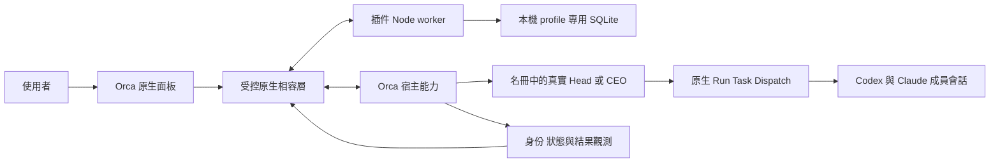

# Orca Team Orchestrator 自用版開發規格

規格日期：2026-10-16。發起者：Lin。目標程式目錄：`team-orchestrator-orca-plugin/`。

> 2026-10-27 狀態提示：本輪進度與阻塞見[最新交接](handoff-2026-10-27.md)。下文 profile 專用 SQLite 是原 Orca 規格的歷史設計，不代表目前共用系統已接受的儲存契約；共用架構與遷移決策仍以現行地圖為準。

> 2026-10-18 更新：本文件保留原始規格與當時狀態。Roster／New team 的最終介面、模板、主管會話交互、初始啟動方式及專案綁定，以已接受的 [ADR-001](../team-orchestrator-orca-plugin/docs/ADR-001-roster-new-team.md) 為準；相關衝突條款已被替代。下文「功能尚未實作／驗收」是 2026-10-16 的歷史狀態，不代表目前插件整體狀態；現況與驗證邊界見插件 README 及 ADR。

本文件是已確認決策的開發閱讀版，對應 [Orca 原生 Team Orchestrator 開發 spec 地圖](https://github.com/herman925/925-cc-plugins/issues/95)。各決策 ticket 的 resolution 保存決議與來源，本文件將其整理成實作與驗收契約。共用名詞見 [GLOSSARY.md](../GLOSSARY.md)。原 Orca 專屬地圖保留為歷史脈絡；跨 Claude Mod 與 Orca 的共享系統後續規劃見 [Map: Team Orchestrator — Claude Mod and Orca](https://github.com/herman925/925-cc-plugins/issues/2)。本倉庫的追蹤器操作說明見 [Wayfinding operations](./wayfinding.md)。

**狀態：開發規格定稿，功能尚未實作／驗收。** 本次交付文件、詞彙與 GitHub 決策同步，不改動插件功能、不提升插件版本、不發布插件。下列「必須」是後續開發要求，不代表現有 `0.1.06` 已具備。

## 1 目標與支援邊界

第一階段讓 Lin 與 Herman 在原版 Orca 上實際使用團隊編排。產品是 Orca ADE 的原生插件，使用者透過同一套面板操作；OS、provider 與執行位置差異由宿主整合層處理。

| 範圍 | 第一階段契約 |
| --- | --- |
| 桌面 | macOS 與 Windows；只承諾實測通過的 build，兩台電腦不必同版本 |
| 執行位置 | 本機與 Orca 已連線的 SSH 工作區；桌面 OS 不等於執行主機 OS |
| 專案 | Git 專案及一般非 Git 資料夾，使用已存在且明確選定的 Orca 工作區 |
| Agent | Codex、Claude Code，首版包含同團隊混用；其他 agent 留待驗證與後續擴展 |
| 安裝 | 原版 Orca＋插件隨包自動相容層；不要求手工修補 Orca、操作 debugger 或另裝某 CLI 的團隊插件 |
| 初始啟動 | 啟用或重啟 Orca 後，若未由事件激活，允許從 Orca 命令面板執行一次「啟動 Team Orchestrator」 |
| 兩人使用 | 各自管理自己的團隊；交換新格式配置，不共管同一個運行中團隊 |
| 階段二 | 官方 API 接納、公開推廣等不阻擋第一階段 |

若保持原版 Orca 的路線無法取得必要能力，記錄可重現證據，重開 [宿主整合與版本支援決策](https://github.com/herman925/925-cc-plugins/issues/98)。不得自行改成自訂 Orca 安裝包，或以較弱的操作冒充已達成的功能。

Orca／provider 原有的登入、SSH 連線與授權仍由其正常流程處理。使用原生 orchestration 所需的 Experimental 設定、執行宿主的 CLI 控制權等，均納入啟動前檢查；缺失時顯示具體處理方式，不代替使用者暗中批准。

## 2 團隊與身份

決策來源：[定義團隊成員、會話與任務的領域模型](https://github.com/herman925/925-cc-plugins/issues/99)。

團隊是持久班底，同時處理一個總目標，內部任務可以並行。新總目標建立新的團隊工作紀錄；跨專案復用時複製配置，建立獨立團隊，不沿用原團隊的身份、對話或歷史。

| 概念 | 最少身份與關係 | 權威來源 |
| --- | --- | --- |
| Team | 持久 team ID、專案歸屬、名稱、配置版本、成員名冊 | 插件 |
| Member | 持久 member ID、所屬團隊、角色、直屬上級、agent／模型偏好 | 插件 |
| TeamWork | 一次總目標、固定工作區與執行主機、配置版本、最高主管、結案狀態 | 插件的業務紀錄 |
| SessionBinding | member、固定執行範圍與 Orca session／terminal 的對應；開始總目標後關聯 TeamWork，包含執行實例與有效性證據 | 插件保存映射；Orca 證明實際會話與存活性 |
| NativeRunBinding | TeamWork、主管及其原生 Run 的對應；Run ID 不等同 team ID | Orca 提供原生 Run，插件驗證與保存關聯 |
| TaskBinding | 工作項目、負責成員、直屬驗收者、修改範圍與原生 Task 對應 | Orca 執行狀態＋插件的業務關聯與驗收 |
| Dispatch | 任務的一次執行嘗試、實際執行者及回報權限 | Orca |
| Operation | 一次插件操作的 request ID、輸入指紋、意圖、回執及未知結果 | 插件操作日誌；效果由宿主證據確認 |

同一成員同時最多一個可接收任務的活躍綁定。名稱只是顯示欄位；同名 tab、provider 對話名稱或畫面焦點都不能取代身份。更換會話不等於換成員，跨 provider 交接也不等於完整轉移原生對話。

TeamWork 建立時固定專案、工作區種類及執行主機。之後切換 Orca 畫面不得重定向，也不應單因焦點改變而中止仍有效的工作。每次操作重新檢查的是已綁定目標的存在、連線與權限。

最高主管是名冊中的 Head／CEO，不另外建立隱藏主管。主管以自己的真實 Orca 會話持有 Run consumer 身份；插件不偽造 `--from`、會話身份或 worker 完成回報。多層組織中，需要自行派工的下層主管使用其本人協調的原生 Run，保存父任務／Dispatch 的回報關係；仍屬同一次 TeamWork、同一專案及主機，不藉建立子 Run 繞過 Orca 的深度限制。這是工程映射，需納入層級調度測試。

## 3 啟動 成員變更與恢復

決策來源：[團隊建立、按需啟動與恢復流程](https://github.com/herman925/925-cc-plugins/issues/100)、[agent 能力與權限邊界](https://github.com/herman925/925-cc-plugins/issues/102)。

| 情境 | 行為 |
| --- | --- |
| 建隊 | 保留 Squad、All-Purpose Team、Tech Team 及原有層級表單；名冊與配置先保存 |
| 開始工作 | 預設啟動最高主管及部門主管；其他成員首次取得任務時啟動。保留「全部啟動」選項 |
| 工作目錄 | 成員共用選定工作目錄，不自動為每位 worker 建立 Git worktree |
| 並行 | 不增加 worker 並行數上限；仍須遵守任務依賴、修改範圍協調及宿主實際能力 |
| 空閒 | 不自動關閉 agent 會話。Orca 回收插件背景 worker 與關閉 AI 成員是不同事件 |
| 手動關閉會話 | 成員仍在名冊中，下次派工可以按需喚醒；不將此操作解讀成永久停用成員 |
| 新總目標 | 使用新對話，載入角色、專案資訊及交接摘要；保留成員與歷史紀錄，不留下兩個活躍收件會話 |
| 個別成員啟動失敗 | 保留成功的成員，等待受影響的任務，其他獨立且不衝突的工作繼續 |
| 舊會話已確認停止 | 優先由 Orca 原生續接；無法續接時，上級檢查交接紀錄後安排新對話 |
| 最高主管無法續接 | 交給使用者決定；不自行建立另一個主管接管權威 |
| 舊會話是否仍在運作不明 | 保留綁定與操作紀錄，對帳或交使用者處理，不自動重複啟動 |
| 增員 | 主管提出建議，使用者確認後新增；使用者也可由面板直接新增 |
| 更換 agent／模型 | 僅在沒有執行中任務時操作；先結清舊綁定，再以新對話交接，身份與歷史保留 |
| 移除成員／改匯報關係 | 等目前總目標結束後執行；期間可以停止對該成員派發新任務 |

保存團隊配置與啟動是不同效果；既有「建立並啟動」流程可以連續完成兩者，但必須先保存再啟動。主管準備會話可以在尚未交辦總目標時等待指令，仍須有固定執行範圍與有效綁定。第一個總目標可使用該尚未承接過工作的準備會話；完成一個總目標後再接新目標，才依已確認規則更換新對話。新工作若改變執行範圍，不直接挪用舊綁定。

內建相容層必須區分以下證據，不用一個 `ready` 或 `running` 布林值取代：

| 證據 | 可表達的事實 |
| --- | --- |
| 意圖已保存 | 插件已記錄要求，尚不表示宿主已執行 |
| 會話建立回執 | 有實際宿主會話／terminal 身份 |
| 輸入受理或排隊回執 | 目標、角色或任務已交給宿主輸入流程 |
| 開始觀測或合法執行回報 | 有證據顯示成員開始處理 |
| 執行完成回報 | 某個 Task／Dispatch 有原生結果，尚待業務驗收 |
| 任務驗收／總目標驗收 | 分別由直屬主管／使用者作出的接受決定 |
| Unknown／unsupported | 無法確認，或宿主無法提供這種觀測；不推定死亡、失敗或完成 |

`turnStart` 的 observed、permission、unsupported、unobserved 需要保留語義。逾時、睡眠、SSH 斷線或沒有新事件都不是死亡證明。結果未知不自動釋放修改範圍給另一成員重做。

## 4 任務 消息與驗收

決策來源：[任務派發、上下級消息與完成證據](https://github.com/herman925/925-cc-plugins/issues/101)。

- 一般派工與回報走直屬上下級；主管間可以協調。worker 直接合作需由主管明確指定對象，結果回報原主管。
- 主管派工前說明修改範圍，重疊範圍的任務安排順序。插件保存範圍並提示衝突；此為調度與協作約定，不承諾攔截任意 agent／外部程式未申報的檔案修改。
- 成員回報執行完成後，由直屬主管檢查成果與驗證證據，再接受或要求返工。原生 Task 的 completed 不直接等同產品的「驗收完成」；後續依賴工作須等待對應驗收通過。
- 最高主管提交整體成果與證據後，等待使用者確認；確認後才結案並開始下一個排隊總目標。此規則針對插件中的工作，不改變本次 wayfinder 自動接續議題的偏好。
- 同一任務連續兩次明確執行失敗，由最高主管整理原因與選項交給使用者。此前主管可修正方法或換人；未知結果不算可自動重試的明確失敗。
- 工作疑問先交直屬主管；需要使用者取捨的事項由最高主管集中提出。等待答案時，其他獨立任務繼續。Orca／provider 的登入和授權提示仍走原生流程。

消息必須關聯 TeamWork、任務／Dispatch（適用時）、真實發送者及收件者。已入列、輸入已受理、開始處理、執行完成、主管驗收是不同事實。以穩定請求 ID 和原生事件／消息 ID 去重，重複點擊或重播不產生第二次效果；舊嘗試的遲到回報只附到舊嘗試，不能完成新嘗試。依賴順序以任務關係與身份判定，不以畫面上的消息時間順序猜測。

未啟動或關閉的合法成員可以按需喚醒。跨工作區、錯誤主機、身份無法驗證或已失效的綁定不得被當作原收件者使用。轉向指令先交最高主管更新計畫並通知受影響成員，不把文字廣播當成所有成員已立即停止或改做新任務。

## 5 Agent 能力與角色內容

決策來源：[agent 能力、混合團隊與權限邊界](https://github.com/herman925/925-cc-plugins/issues/102)。

首版需支援同團隊混用 Codex／Claude Code，包含跨 agent 派工、回報、提問與恢復。角色層級可提供預設選擇，個別成員保存自己的 agent、模型和 effort 偏好；使用 Orca 的已配置啟動方式及目標主機上的能力，不在產品核心以 provider 名稱推導全部行為。

模型 ID 是 provider 的值，不硬編碼成跨 provider 共用全集。保留 requested／effective 的區別；不支援的明確選擇必須回報，不靜默改成預設。無法取得實際模型或上下文用量時顯示未知，缺少這些可選資料不阻擋可靠的核心編排。

「主管以規劃和驗收為主」「成員不自行另開 subagent」先以角色指令與可驗證的派工權限實現。插件對自己承接的命令驗證身份、目標與範圍，但不宣稱能跨 provider 強制攔截所有工具。原生 Dispatch 深度限制不等同禁止 provider 內建 subagent。

角色說明、個人工作習慣與協作規則由面板保存、版本化並可匯出。啟動和交接由插件提供有效版本，不以 agent 聲稱自己已寫檔作為保存證明。進行中的任務保留其角色／配置版本來源；一般角色文字更新於下一次啟動或交接提供，不能悄悄改寫過去的操作證據。即時工作要求走主管指令流程。

## 6 宿主整合與持久化

下列是經採納計畫選定的工程設計。來源證明相關程式存在，不代表相容層已實作或實機已通過。

### 6.1 初始化與版本化相容層

保留合法的 `orca-plugin.json`、`main`、自身 command 及事件訂閱。啟動命令先觸發 Orca 正常 worker activation，再自動檢查原生 consent、父進程、實際 profile、應用 build、Electron／Node 能力與 handler 契約；面板載入不等於 worker 已起跑。

修正現有 macOS fuse 讀取：從 `.app/Contents/MacOS/` 入口解析到 Electron Framework；Windows 按實際 executable 包裝檢查。區分文件定位失敗、fuse 關閉、debugger port 衝突、PID 不符與不支援 build。不得修改已安裝應用或強行開啟被關閉的 fuse。

相容層只允許本插件的已宣告命令及內部操作白名單，沿用當前 panel／window ownership、consent 和 admission 檢查。呼叫宿主時使用真實 Electron IPC 事件與正確 main-frame 來源，不能人工組 `{sender}` 冒充事件。私有 runtime 方法名不能直接成為 panel 可任意傳入的參數，也不能虛構 manifest capability。

面板→worker 連線、可信工作區 scope、真實主管權威是三項獨立檢查。初始化命令回報各項結果並可安全重試，不以 nonce ping 成功宣稱整個團隊已能工作。

### 6.2 最小內部操作契約

| 插件內部能力 | 責任與必要結果 |
| --- | --- |
| 初始化與探測 | build、能力、profile／執行宿主、失敗原因；敏感內部路徑不直接暴露給 HTML |
| 綁定 TeamWork scope | 使用者選定的工作區／folder 身份與 execution host；後續不能依 cwd 或焦點重選 |
| 建立成員會話 | member／work／operation 關聯，宿主 outcome kind、實際 session 或 terminal 身份、輸入回執 |
| 向已綁定主管提交要求 | 合法使用者來源、明確目標、消息識別及 accepted／queued／observed／unknown 區別 |
| 讀取團隊快照 | 明確 Run 的 Task、Dispatch、worker 與結果；不消費／ack 主管 inbox |
| 恢復或停止 | 驗證綁定與原生執行實例，返回實際效果或 unknown，不只回「命令已送出」 |

這張表定義插件自己的接口責任，不是新增的 Orca 公開 SDK。

Node worker 先保存操作意圖，主進程相容層執行受限宿主操作，再保存回執。需要長時間觀察的操作先回 operation ID，由後續查詢對帳；UI 逾時不等於後端動作已取消。

### 6.3 使用 Orca 的原生執行能力

優先經過真實的 `runtime:call` 與已註冊 `agent.launch`／`agent.launchReplay`，讓 Orca 選擇 terminal／structured 模式及套用設定。CLI 未廣告 `agent launch` 不能作為硬拼 `codex`／`claude` shell 命令的理由。`agentArgs` 省略與傳 null 語義不同，繼承設定時不得清空它。[既有 IPC](https://github.com/stablyai/orca/blob/9fdd90ffa7721e145f1353ad9fb9df2f70c31f43/src/main/ipc/runtime.ts#L63-L87)、[啟動參數](https://github.com/stablyai/orca/blob/9fdd90ffa7721e145f1353ad9fb9df2f70c31f43/src/shared/rpc-contract/agent-launch-params.ts#L44-L87)

主管由插件透過宿主啟動為真實名冊成員，並在自己的會話內使用版本相符的 Orca orchestration 能力。Run 建立／恢復及 Task／workerStart 由真實主管身份執行；不把「讓某個既有匿名 agent 幫忙建隊」當作啟動方式，也不讓插件偽造主管 caller 身份。[Run 綁定](https://github.com/stablyai/orca/blob/9fdd90ffa7721e145f1353ad9fb9df2f70c31f43/src/main/runtime/rpc/methods/orchestration/runs/runs.ts#L28-L110)

按需成員由原生 workerStart 路徑建立；已預建且符合工作區／agent 條件的成員可由其重用 terminal 路徑指派，不同時覆寫模型／effort。正式工具協議必須攜帶已登記 member 與 TeamWork 關聯，並與原生 Run、Task、Dispatch 及真實執行者核驗；不能只按名字附會。

workerStart 回覆包含 Run／Task／Dispatch 與階段資訊，不能假定具有頂層 member ID 或 handle。必要時讀取 worker projection 取得實際身份。預建會話可能是原生 worker 的 external 資源，不能假定 worker-release 會關閉它；保持會話開啟的政策由相應生命週期處理。[placement](https://github.com/stablyai/orca/blob/9fdd90ffa7721e145f1353ad9fb9df2f70c31f43/src/main/runtime/rpc/methods/orchestration/worker/worker-start-agent-placement.ts#L78-L105)

觀測使用明確 Run 的 runList／runShow、taskList、dispatchShow 及必要的 worker projection。workerShow／workerRead 不消費 inbox，但可能校正宿主 epoch 後的 unknown 狀態，不能把它們描述為絕對無副作用；SSH 輸出亦可能不完整。UI 不把不完整輸出冒充完整 transcript。

一般資料夾使用既有 folder workspace，不要求建立 Git worktree；原生 folder placement 的此項限制與已選定的共用目錄策略相符。[folder placement](https://github.com/stablyai/orca/blob/9fdd90ffa7721e145f1353ad9fb9df2f70c31f43/src/main/runtime/rpc/methods/orchestration/worker/folder-worktree-placement.ts)

### 6.4 SQLite 與單寫入者

資料保存採用驗證後的 Orca profile 下、插件專用的 SQLite，由插件原生 worker 單寫入者管理。使用 `node:sqlite`，不另裝資料庫服務；其可用性是支援 build 的檢查項。調查時 Lin 的安裝包含 Node 24.21.0、Electron 43.7.5，已以只讀模組檢查確認 DatabaseSync 存在；Windows build 尚待驗證，不能直接套用此結論。

SQLite 保存團隊配置、角色版本、工作／會話映射、操作日誌及使用者／主管驗收紀錄。Orca 仍是原生會話、Task／Dispatch 執行狀態及權威的來源，不另建立與其競爭的執行真相。此設計避免將持續累積的歷史放入容量有限的公開 plugin KV store。

最少交易規則：

1. request ID 與輸入指紋唯一；同 ID 不同輸入拒絕，已保存回執可直接重讀。
2. 意圖提交後才呼叫宿主；取得實際身份後先保存，再做命名等跟進工作。
3. crash／斷線留下的 intent 視為待確認，先查原生 operation／session 證據，不能因本地沒有回執就重新建立。
4. 多 panel 以版本檢查提交變更，避免覆寫別的窗口的新狀態；插件 worker 重啟不丟失日誌。
5. schema 升級先保留可恢復備份，再交易式遷移；讀取失敗、損壞或不支援 schema 不回成空團隊並覆寫。
6. 手動清理只處理使用者選定的已完成紀錄；運行中、待驗收、待人處理及 unknown 的紀錄保留。清理插件歷史不刪除專案檔案或 provider 對話。

## 7 資料交換與面板

決策來源：[團隊資料保存、升級與遷移](https://github.com/herman925/925-cc-plugins/issues/103)、[原生面板操作與錯誤復原體驗](https://github.com/herman925/925-cc-plugins/issues/104)。

新格式團隊範本包含配置與角色內容，可匯出並由另一位使用者匯入建立獨立團隊。匯入要重新產生 team／member 身份並確認目標專案，不攜帶活動會話、Run／Dispatch 權威、登入資料或運行中任務，也不因匯入立即啟動成員。

首版不提供舊 Claude mod 或舊 Orca 原型資料匯入。舊檔案／KV 資料保留，新狀態不覆寫舊格式；也不把看到的舊會話當作新團隊的成員。摘要、任務結果與關鍵操作紀錄保留至手動清理；完整對話由 Orca／provider 管理，插件保存必要引用而不複製全部內容。

主入口保留組織樹與名冊，建隊維持 Setup → Models → Preview → Launch。點擊成員查看其任務、實際綁定會話、模型偏好與最近回報；另有任務及「待你處理」區域。建立團隊不混同提交一次總目標。

低保真資訊順序：頂部顯示團隊、已綁定專案／主機與連線狀態；主區是可點擊的組織樹和名冊；任務與待處理事項有獨立入口及數量提示；成員詳情顯示角色、綁定、當前任務、回報與操作。未知結果在對應成員／任務旁可見，不藏在全域 toast，也不以重試按鈕暗示可安全重開。

面板需提供以下可辨識操作：

- 建立／複製團隊、編輯角色、選擇並確認工作區、開始或排隊總目標。
- 打開已驗證綁定的成員會話，查看執行證據與資料是否完整。
- 提出／確認增員、在任務空檔更換 agent，安排下次工作才生效的組織調整。
- 停止派發新任務與停止目前執行分開呈現；後者使用宿主正常停止能力並顯示回執，不假裝能回滾已修改的檔案。
- 回答最高主管的問題、驗收／要求補做總目標、查看與處理 unknown 操作。

僅在需要使用者決定、需要登入／處理故障，以及總目標交付時發通知。一般成員進度留在面板。通知能力使用既有合法 capability 並遵守正常 consent；診斷細節可展開，但不能要求使用者理解 inspector 或內部 RPC 才能操作。

## 8 開發階段與驗收

決策來源：[跨平台驗收與 spec 完成標準](https://github.com/herman925/925-cc-plugins/issues/105)。

### 開發順序

| 階段 | 可檢查的結果 | 不通過時 |
| --- | --- | --- |
| 宿主接入驗證 | 原生命令激活、macOS／Windows 包裝判斷、可信 scope、真實 Head 啟動、合法 Run 綁定、結果觀測 | 保留證據並重開宿主整合決策，不自行改版 Orca |
| 狀態與編排 | 持久身份、SQLite／操作日誌、按需啟動、任務／驗收、消息去重、交接與 unknown 對帳 | 不將單純 tab 建立標成完整團隊可用 |
| 面板與資料 | 角色管理、配置交換、成員調整、關鍵通知、清楚的復原入口 | 不以假資料補齊觀測欄位 |
| 4 人實機閉環 | Lin 與 Herman 的已驗證 build、混合團隊在指定環境完成實際工作 | 未通過組合不標示已支援 |
| 規模擴大 | 11／21 人預設的結構與調度先通過，再逐步增加實機負載驗證 | 不阻擋已驗證的 4 人自用流程，也不宣稱大型隊伍已經驗證 |

### 首輪實機矩陣

每格至少記錄桌面 build、runtime／執行主機、agent／模型、workspace 種類、操作與 Task／Dispatch 回執以及結果。使用 4 人 Squad，整組測試中兩種 agent 均需擔任過主管和 worker。

4 人是首輪實機驗收規模，不是產品新增的並行人數上限。

| 桌面 | 執行位置 | 必須覆蓋的 workspace | 狀態 |
| --- | --- | --- | --- |
| macOS | 本機 | Git 與一般資料夾 | 待實作後驗收 |
| macOS | SSH | Git 與一般資料夾 | 待實作後驗收 |
| Windows | 本機 | Git 與一般資料夾 | 待實作後驗收 |
| Windows | SSH | Git 與一般資料夾 | 待實作後驗收 |

### 必要情境

| 情境 | 通過條件 |
| --- | --- |
| 冷啟動及授權 | 需要時一次原生啟動命令即可進入可檢查狀態；缺少能力或 consent 有明確原因 |
| 角色與混合派工 | 實際身份、agent、任務、上下級與角色版本可對應，不多開未批准的名冊成員 |
| 共用目錄 | 已申報的重疊修改按主管安排執行；未把這種安排誤標為工具級隔離 |
| 任務與總目標驗收 | worker 回報、主管驗收、使用者結案是三個可分辨步驟；下一個總目標不提前開始 |
| 焦點與身份 | 切換工作區、同名會話、同專案其他團隊或舊綁定不導致誤投 |
| 重試與遲到回報 | 重複請求只產生一次已確認效果；舊 Dispatch 不完成新嘗試；unknown 不自動重開 |
| 手動關閉與空閒 | 空閒會話保持開啟，手動關閉後按需喚醒，不等同刪除成員 |
| 中斷與 SSH | 睡眠、斷線、worker／Orca 重啟後能重建已知映射或誠實保持 unknown，不把缺少事件當死亡 |
| 交接與配置變更 | 新總目標用新對話；無法續接有上級／使用者決定紀錄；換 agent 不留下雙活綁定 |
| 部分失敗與升級 | 只阻塞相關工作；兩次明確執行失敗向使用者升級，其他獨立任務不被無故停止 |
| 多層組織 | 父任務、主管 Run、下屬 Dispatch 與回報權限對應正確，不因子 Run 重置深度或冒充權威 |
| 持久化與資料清理 | 多 panel 不覆寫、寫入中斷可恢復；舊資料／損壞資料不被清空；未知與未完成紀錄不被清理 |
| 停用與撤權 | 撤權後插件不能發起新操作；既有 Orca 會話不被無故冒充或刪除，後續效果按證據對帳 |
| 真實狀態 | accepted 不冒充 observed，子 agent 活動不冒充主任務完成，缺少可選資料及不完整 SSH 輸出有標示 |

執行建置、domain／bridge 測試、瀏覽器測試及固定版本 host contract 測試。修正 host 測試的 macOS 臨時路徑 canonicalization，避免 `/var` 與 `/private/var` 的字串前綴判斷造成假失敗。按專案規則重新產生並檢查隨包 `main.mjs`、`runtime-adapter.cjs`、`panel.html`。

驗證證據分開標示：純邏輯測試、模擬宿主、獨立 Electron fixture、真實 Orca＋provider。fixture 的假 CLI 回執不能當成真實 agent 已啟動。測試只能清理自身建立且身份已確認的資源，不能把使用者其他會話視為測試殘留。

## 9 決策追蹤與來源

| 決策 ticket | 已確認問題來源 | 規格落點 |
| --- | --- | --- |
| [宿主整合方式與支援版本](https://github.com/herman925/925-cc-plugins/issues/98) | 自用階段、已驗證版本、原版 Orca、相容層、本機與 SSH | 支援邊界、宿主整合 |
| [團隊成員、會話與任務的領域模型](https://github.com/herman925/925-cc-plugins/issues/99) | Q1–Q6 | 持久團隊、單總目標、複製配置、單活躍綁定 |
| [建立、按需啟動與恢復](https://github.com/herman925/925-cc-plugins/issues/100) | Q7–Q15，及 Q31–Q32 的生命週期影響 | 共用目錄、按需、空閒保留、恢復與部分失敗 |
| [任務、消息與完成證據](https://github.com/herman925/925-cc-plugins/issues/101) | Q10、Q16–Q20 | 交流、修改範圍、主管驗收、使用者結案、失敗升級 |
| [agent 能力與權限](https://github.com/herman925/925-cc-plugins/issues/102) | Q21–Q24、Q31–Q32 | 混合、協作規則、空檔換 agent、成員變更 |
| [資料保存、升級與遷移](https://github.com/herman925/925-cc-plugins/issues/103) | Q25–Q27、Q33 | 各自管理、面板角色、新配置交換、無舊資料匯入、歷史保留 |
| [面板與錯誤復原體驗](https://github.com/herman925/925-cc-plugins/issues/104) | Q28–Q30 | 名冊主入口、原生命令啟動、關鍵通知 |
| [驗收與 spec 完成標準](https://github.com/herman925/925-cc-plugins/issues/105) | Q34–Q35 及所有已確認行為 | 4 人閉環、兩平台／兩位置／兩類 workspace、逐步擴大 |

本倉庫調查基線為 `b36f3be2f664675ee2f79404e00ae57e9ad27d81`。Orca 來源以 `9fdd90ffa7721e145f1353ad9fb9df2f70c31f43`（所觀察的 1.4.222 安裝包）與 `02356732b0a4b8fa46aefead303f6f092611c18d`（研究時 main 快照）區分；不能把 main 新能力當成兩人安裝包已發布的能力。

- [宿主契約與跨平台研究](https://github.com/herman925/925-cc-plugins/blob/dc100f89b8e63f264bfe37a44916c785eb4c9925/docs/research/orca-plugin-host-contract.md)：公開／私有接口、啟動與授權邊界、平台驗證限制。
- [agent runtime 能力研究](https://github.com/herman925/925-cc-plugins/blob/18c60b13e985a54a47c4c47bb41923adb4165e8b/docs/research/orca-runtime-capabilities.md)：Run／Task／Dispatch、真實身份、消息與觀測語義。
- [既有問題分析](https://github.com/herman925/925-cc-plugins/blob/dc100f89b8e63f264bfe37a44916c785eb4c9925/docs/team-orchestrator-orca-analysis.md)：原版機制、macOS fuse 定位復現與當時測試結果。

研究曾提出官方接口路線；第一階段採原版 Orca＋內建相容層，是 Lin 後續作出的產品取捨，不能倒寫成研究已證明這條整合鏈可用。SQLite、操作分層和上述工程映射是本次採納計畫的設計選擇；原生 bridge、Windows、SSH 及真實混合團隊閉環仍須按驗收計畫證明。
