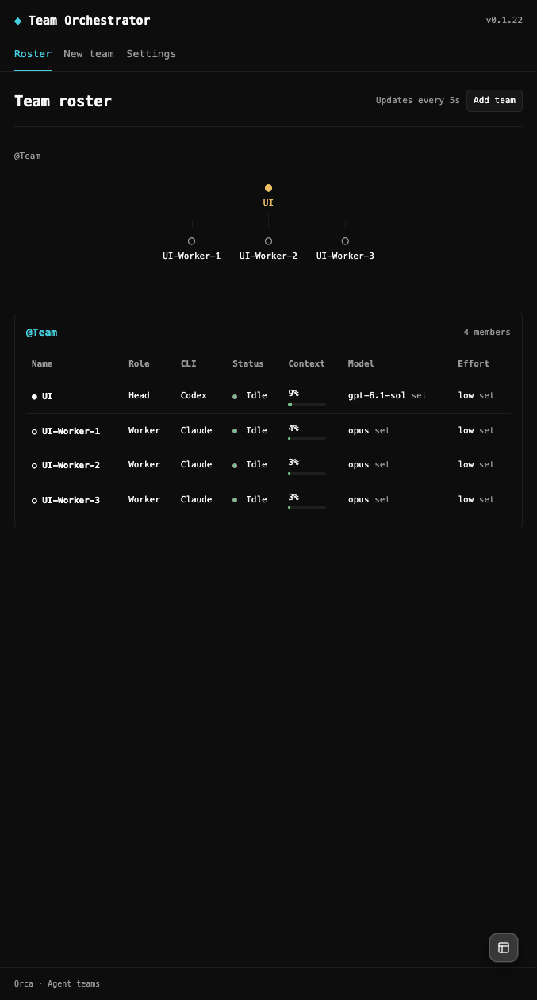

# 0.1.22：Claude statusline 的窗口与百分比

验证日期：2026-10-18。用户授权保留现有 statusline，并增加按会话输出 Context 数据的适配。本机已启用；插件版本为 0.1.22。

## 实现

Settings → Claude context 提供 Connect／Disconnect。连接将当前用户 Claude settings.json 中的 statusLine 扩展为调用随插件提供的观察脚本，完整保存原 statusLine 对象，并继续向原命令转交原始 stdin、stdout／stderr 和退出码。断开恢复原对象及其选项，不覆盖其他设置。安装时以锁及写入前文件比较防止覆盖并发修改，文件原子写入；外部更改后的未知配置不自动覆盖。

观察脚本安装到 Claude 配置目录中的 `team-orchestrator-orca/`，使用宿主自带 Node，无需另装运行时。原 Orca 托管脚本及安装包未修改。固定宿主源码测试确认新命令会被 Orca 识别为用户 statusline，宿主维护托管 hook 时不会替换它。

插件先根据原生会话清单登记团队成员当前的 session、transcriptPath、pane、handle、PTY 及 incarnation。statusline 仅为匹配这份登记的会话输出最少观测，包含 CLI 报告的窗口、输入／缓存用量、百分比、模型、时间及文件身份。输出不包含对话正文、费用、账户凭据或原始完整 JSON；文件权限为 0600。

Roster 在原有终端身份检查中优先读取这些观测。样本必须匹配当前项目、会话、终端实例、transcript inode 及最近响应的输入用量，且不得早于该响应。窗口和百分比采用 CLI 报告值，兼容自定义 `[1M]` 模型。无有效样本时继续显示原有日志 token 数；CLI 的空用量报告清除旧读数。采样仅用于监控，不赋予派工或生命周期权限。

## 验证

- 构建成功，589 项核心测试通过。覆盖窗口／用量字段校验、不同会话和实例隔离、过期及不一致读数、空报告、原命令输入／输出保留、重复连接、断开恢复、并发修改和撤权。
- 完整 33 项浏览器测试通过，包含启用后 1M 百分比、刷新后保留、断开后回退日志用量。随后将测试 transcript 时间改为当前生成时间，并复跑两项受影响的 Context 用例，避免固定日期影响未来运行。
- 三个固定 Orca 源码契约检查通过；最新版本额外运行原生 `getStatusLineSlotState` 和 `applyManagedStatusLine`，确认适配命令不被托管安装流程替换。

## 本机真实结果

macOS arm64，Orca 1.4.229，Electron 43.7.8，宿主 Node 24.21.0。原生插件列表为 running／0.1.22，真实面板显示 v0.1.22。

在用户已有的 `tmp-test / Team` 上启用后，三个正在运行的 Claude Code 会话通过配置热更新自动执行 statusline。未发送模型 prompt、未使用手工构造的 JSON 作为实机证据、未重启或重建团队。实际采样的模型为 `deepseek-v4-pro[1M]`，三个窗口均为 1,000,000。

| 成员 | 实际输入及缓存 token | CLI 报告窗口 | CLI 百分比／Roster |
| --- | ---: | ---: | ---: |
| UI-Worker-1 | 39,622 | 1,000,000 | 4% |
| UI-Worker-2 | 28,076 | 1,000,000 | 3% |
| UI-Worker-3 | 27,763 | 1,000,000 | 3% |

已核对采样文件、后台 Roster 观测和真实面板三者一致。Settings 显示 Connected 及 Disconnect Claude context；安装的观察脚本哈希与构建产物一致。2 个团队、8 个成员、5 个创建请求、1 个 Work／Run、0 个排队目标的身份、配置和绑定保留，测试后恢复原项目会话。

本轮实机验证限于当前 Mac 的 Claude 用户配置和既有三个终端成员。独立账户配置目录、项目级 statusline 覆盖、SSH、Windows，以及实际执行 `/compact`／切换模型的边界未冒充通过；对应字段／失效逻辑由自动测试覆盖。#125 的业务验收状态未在本次改变。

见 [脱敏回执及构建哈希](claude-statusline-context-022.json) 和真实面板：

