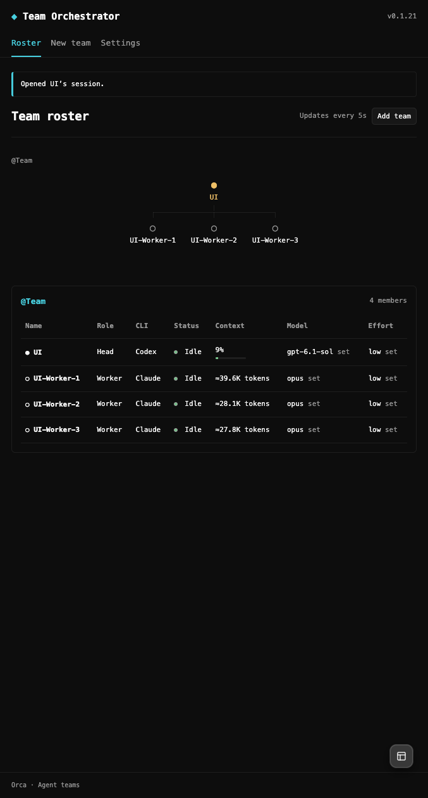

# 0.1.21：成员会话跳转与终端 Context

验证日期：2026-10-18。用户完成四人团队的网页任务测试后，要求点击 Roster 中的 Lead／Worker 直接进入会话，并报告所有终端成员的 Context 均为空。

## 修改结果

列表成员名和组织图节点均使用可键盘操作的按钮，覆盖 Head／CEO、Lead 和 Worker；移除单独的 Open supervisor。点击沿用 `openMember`，使用成员的当前观测绑定或已保存的成功创建绑定。原生身份、实例及项目检查继续执行；没有绑定时禁用，失效绑定报错，不创建或恢复会话。

原 Context 实现仅处理 structured Chat，本机终端分支只读取活动状态，因此终端成员一直显示 `—`。现在通过 `session.tabs.list` 中精确匹配的项目、tab、leaf、PTY incarnation、terminal handle 和 providerSession 定位 hook 上报的 transcriptPath，再读取有界文件尾部。读取后再次核对 provider session，Roster 继续复核终端实例、运行时和主机。

Codex 使用当前对话的 `last_token_usage.total_tokens` 与 `model_context_window`，不使用累计 token。Claude Code 使用最近一次非 sidechain assistant 响应的输入、缓存创建及缓存读取 token，不累计输出；没有窗口上限时显示 token 数并标记估计，不按模型名字推测容量。压缩边界使旧读数失效，缺少精确身份、来源或窗口证据时保留相应未知值。远端路径不会在本机读取。只保存提取出的观测，不将 transcript 正文传给面板或写入持久化回执。

文件读取限制为 512 KiB 尾部，Codex 另读最多 256 KiB 头部核对对话 ID／cwd。文件元数据未改变时复用缓存；变化中的文件、符号链接、非普通文件或身份不匹配均拒绝读取。各条缓存仅保留身份键、文件版本和用量，最多 256 条。

## 自动验证

- 构建成功，583 项核心测试通过。
- 32 个浏览器用例均已验证：完整运行 31 项通过，剩余一项只因断言使用小写 `k` 而实际国际化格式为大写 `K` 失败；修正断言后单独复跑通过。覆盖列表、组织图、键盘打开 Lead、terminal／structured Worker、失效绑定不重建、未知启动禁用、Context 无窗口时的显示及刷新。
- 三个固定宿主源码契约检查通过；最新宿主额外核对 session tabs 的字符串 worktree、pane／PTY 字段及 providerSession 的 transcriptPath 契约。固定源码检查不代表三台实机验收。

## 真实 Orca 验证

环境：macOS arm64，Orca 1.4.229，Electron 43.7.8，宿主 Node 24.21.0。开发插件实际指向本仓库，文件更新后宿主已自动载入 0.1.21，原生插件列表为 running，真实面板显示 v0.1.21。

使用用户在 `tmp-test` 建立的既有 `Team`，不重建成员、不发送任务。通过真实插件按钮依次打开组织图的 UI-Worker-1、列表的 UI-Worker-2、组织图的 UI-Worker-3 和列表的 UI；每次均通过原生 session tabs 的 activeTabId 和 terminal handle 核对正确成员。系统坐标点击曾被窗口焦点检查拒绝，没有计为成功；最终实测调用真实面板 DOM 按钮，经过原有面板桥和原生打开接口，并核对实际选中会话。

| 成员 | 真实读取 | 面板显示 |
| --- | --- | --- |
| UI（Codex） | 70,722 / 828,400 tokens | 9% |
| UI-Worker-1（Claude Code） | 最近输入 39,622 tokens，无窗口上限 | ≈39.6K tokens |
| UI-Worker-2（Claude Code） | 最近输入 28,076 tokens，无窗口上限 | ≈28.1K tokens |
| UI-Worker-3（Claude Code） | 最近输入 27,763 tokens，无窗口上限 | ≈27.8K tokens |

悬浮说明包含原始计数、报告时间及缺少窗口时的说明。后台读取和真实面板显示一致。旧的 QA125-Focus 保留其 stale handle／未启动状态及 `—`，没有以其他同名成员补数据。

导航前后 2 个团队、8 个成员、5 个创建请求、1 个协调 Work／Run 和 0 个排队目标的身份、配置及绑定保持一致；观测时间正常更新。测试后恢复原项目会话。用户报告业务任务测试无问题，但本记录不宣告 #125 的全部证据审计完成，也未关闭 issue。

脱敏数据及构建哈希见 [JSON 回执](roster-navigation-context-021.json)，真实面板见下图。

